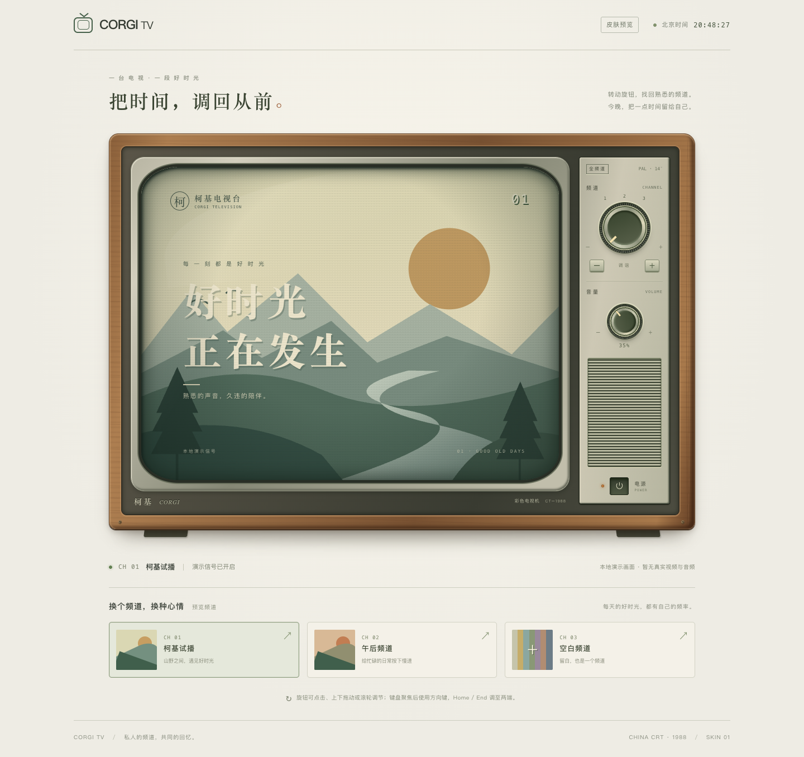
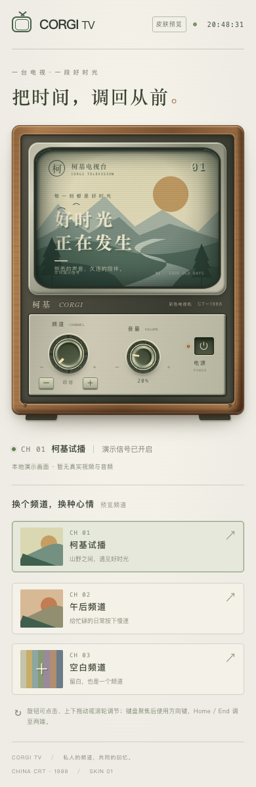

# M2 测试报告

日期：2026-11-03。结论：M2实现及下列自动验证完成，提交用户验收；未进入M3。

## 交付及环境

已实现React CRT电视界面、可插拔Skin接口、频道/音量旋钮、电源与切台过渡、4:3屏幕、无信号彩条、键盘操作和小屏布局。全部画面是标注的本地SVG演示信号，不含真实音视频集成。

系统macOS 26.6.2（25G83）；Chrome 156.0.8078.79、Edge 149.0.4022.80使用已安装品牌浏览器的headless模式；Safari 26.6.2使用官方safaridriver。开发页 `http://127.0.0.1:5190/`，生产预览5191；请求仅本机127.0.0.1，无媒体源。详细版本及运行条件见各证据目录environment.json。

## 最终检查

| 检查 | 结果 | 证据 |
| --- | --- | --- |
| ESLint | PASS | [lint.txt](evidence/m2/lint.txt) |
| TypeScript | PASS | [typecheck.txt](evidence/m2/typecheck.txt) |
| 核心与控制器55项测试（既有51+新增4） | PASS | [unit-tests.txt](evidence/m2/unit-tests.txt) |
| 生产构建 | PASS | [build.txt](evidence/m2/build.txt) |
| Chrome生产构建：开机→空白频道→关机，无控制台错误/外部请求 | PASS | [production-smoke.json](evidence/m2/production-smoke.json) |

## Chrome / Edge 逐项验证

两浏览器各11 PASS，共22 PASS；下表每项均在两个浏览器执行。详细断言与复现步骤在 `tests/skin-browser.mjs`。先启动 `npm run dev`，分别执行 `node tests/skin-browser.mjs chrome`、`node tests/skin-browser.mjs msedge`。

| 条件/操作及判据 | Chrome | Edge |
| --- | --- | --- |
| 初始关机，没有演示画面 | PASS | PASS |
| 点击电源后显示画面，屏幕748×561，4:3 | PASS | PASS |
| 上下台、循环、选第三台显示无信号 | PASS | PASS |
| 频道旋钮键盘、点击、指针拖动、滚轮 | PASS | PASS |
| 音量键盘上下限、最大值点击、拖动、滚轮 | PASS | PASS |
| Tab焦点及电源空格操作 | PASS | PASS |
| 快速开关机和切台，最终状态一致 | PASS | PASS |
| 减少动态效果：无屏幕动画，旋钮过渡0s | PASS | PASS |
| 390px布局与控制可用 | PASS | PASS |
| 320px无横向溢出 | PASS | PASS |
| 无运行时/控制台错误，无外部媒体请求 | PASS | PASS |

证据：[Chrome结果](evidence/m2/chrome/results.json)、[Edge结果](evidence/m2/msedge/results.json)。同目录包含environment.json、errors.json、requests.json及开机、关机、无信号、390/320px截图。

## Safari 逐项验证

官方Safari会话测试5 PASS。先运行 `/usr/bin/safaridriver -p 5192`，然后执行 `node tests/skin-safari.mjs`。

| 条件/操作及判据 | 结果 |
| --- | --- |
| 初始关机 | PASS |
| 开机渲染与748×561的4:3屏幕 | PASS |
| 切台与无信号 | PASS |
| DOM派发键盘事件后音量状态变化 | PASS |
| 关机卸载画面 | PASS |
| Safari原生鼠标拖动、滚轮及可信键盘输入 | NOT RUN |
| Safari小屏与减少动态效果专项 | NOT RUN |

[结果](evidence/m2/safari/results.json)、[环境及交互限制](evidence/m2/safari/environment.json)。Safari使用DOM点击和派发事件，不能把它作为原生指针/可信用户手势证据；Chrome/Edge另有浏览器输入自动化证据。

## 修复及历史证据

- 初次渲染发生React未定义，补齐JSX编译配置后修复；保留chrome-initial。
- 首轮标题匹配未兼容换行，修正测试断言；保留chrome-first-render。
- 更新配置触发Vite页面重载，导致运行中的测试失败；chrome-reload-interrupted、msedge-reload-interrupted为受干扰运行，不计入最终通过数。
- 生产检查发现favicon 404，补齐静态图标后复测PASS；原始production-initial.json保留。
- 最终有效证据为chrome、msedge、safari及production-smoke.json；历史失败不删除，不与最终运行混算。

## 风险与验收边界

- 最终实际浏览器检查共28 PASS（Chrome11、Edge11、Safari5、生产1）；Safari上述两个专项NOT RUN，未宣称全浏览器交互覆盖。
- 真实视频、声音、播放器断流与时间同步在M2集成页NOT RUN，本阶段仅验证本地演示皮肤。M0仍为17 PASS / 0 FAIL / 3 BLOCKED，长源延期及B站受限策略不变。
- [依赖审计](evidence/m2/npm-audit.json)记录11项moderate、0 high/critical，位于开发工具依赖链；本轮未强制降级工具链，保留后续升级事项。
- 当前支持提交M2用户验收，视觉风格及操作手感仍请用户实际确认。未经用户确认不启动M3；未实现频道管理、排片编辑、业务存储、平台播放器集成或部署。

## 手动验收建议

打开本地5190预览：点击电源，体验频道与音量旋钮（本轮无声音），切到第三台查看彩条，再关机。确认CRT外观、屏幕比例、切台反馈及旋钮手感是否符合预期。

