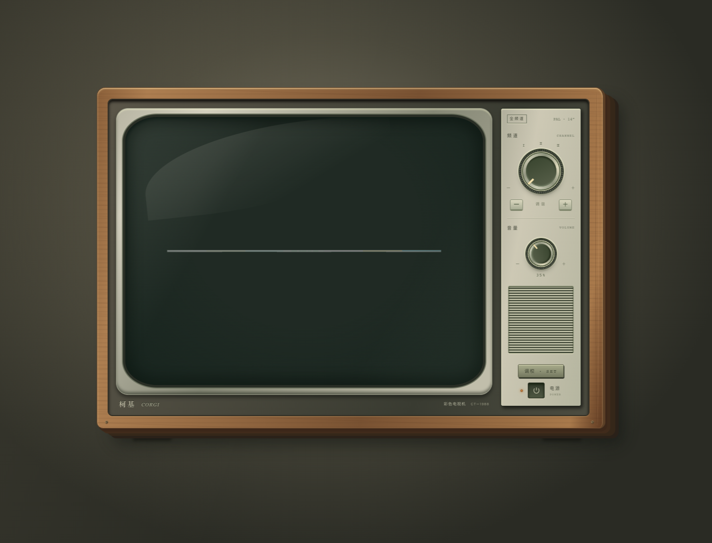
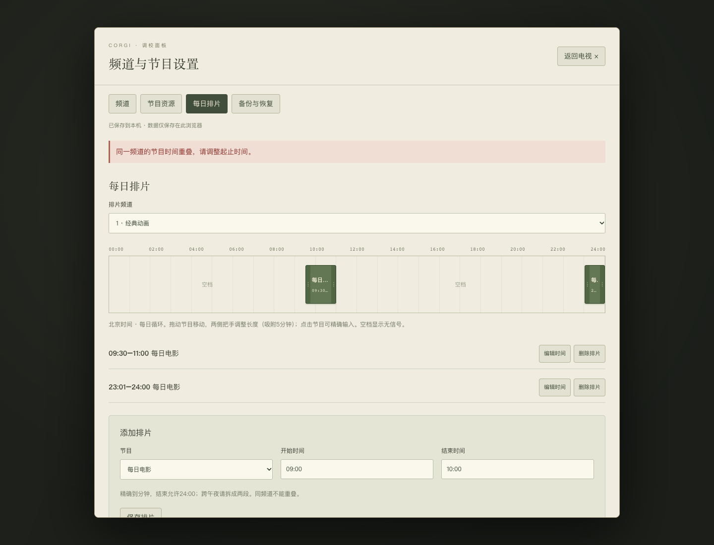

# M3 测试报告

2026-11-03（北京时间）。M3本地管理功能及用户要求的视觉调整已交付，等待用户验收；M4未启动。

## 交付结论

- 主界面只展示复古电视机。已去除外围标题、导航、频道卡片和页脚；用CSS层次、厚边、内凹屏幕、光影及可交互DOM增强机壳立体感。
- 机身「调校 · SET」打开管理弹窗，包含频道管理、节目资源、每日排片、备份与恢复。
- IndexedDB/Dexie持久化、校验、原子导入、保存失败提示和多标签页版本冲突保护已实现。
- 最终64项单元测试PASS；Chrome 13、Edge 13、Safari 5、生产构建1，共32项浏览器检查PASS。以下单独列出的Safari专项NOT RUN，不宣称三个浏览器覆盖相同范围。
- 真实音视频播放及部署仍属于M4，本轮NOT RUN。输入链接后屏幕仅显示节目标题及待接入提示，没有伪装播放成功。

## 环境与复现

系统macOS 26.6.2（25G83）；Chrome 156.0.8078.79、Edge 156.0.4314.58，已安装品牌浏览器headless模式；Safari 26.6.2，官方safaridriver，原生element click/clear/send keys。版本详见各environment.json；JSON日期采用UTC，报告日期采用北京时间。

开发页`http://127.0.0.1:5190/`，生产预览`http://127.0.0.1:5191/`。输入的example.com视频链接只是测试配置，不发起媒体请求；B站BV仅验证输入归一化与受限提示。网络记录仅127.0.0.1。

复现：启动`npm run dev`，分别运行`node tests/management-browser.mjs chrome`、`node tests/management-browser.mjs msedge`。Safari先启动`/usr/bin/safaridriver -p 5192`，再运行`node tests/management-safari.mjs`。构建后启动`npm run preview`，运行`node tests/management-production.mjs`。测试使用隔离浏览器会话，不修改用户正常浏览器中的配置。

## 工程检查

| 检查 | 结果 | 证据 |
| --- | --- | --- |
| ESLint | PASS | [lint.txt](evidence/m3/lint.txt) |
| TypeScript | PASS | [typecheck.txt](evidence/m3/typecheck.txt) |
| 单元测试64项（M1/M2既有55 + M3新增9） | PASS | [unit-tests.txt](evidence/m3/unit-tests.txt) |
| 生产构建 | PASS | [build.txt](evidence/m3/build.txt) |
| 生产页面创建频道、刷新保留、无控制台错误和外部请求 | PASS | [production-smoke.json](evidence/m3/production-smoke.json) |

新增单元测试覆盖关联删除、分钟边界、吸附/时长/日内限制、备份往返、无效结构/重叠/引用/凭证拒绝、配置更新后的当前频道重评估及来源元数据保留规则。不是用单元测试代替浏览器持久化证据。

## Chrome / Edge 逐项结果

| 条件、操作与判据 | Chrome | Edge |
| --- | --- | --- |
| 单电视主界面；空频道无信号；设置弹窗、Escape、焦点恢复及Tab循环 | PASS | PASS |
| 频道创建、重命名、排序、启停；重复编号拒绝且数据不变 | PASS | PASS |
| HLS节目输入、B站BV归一化及受限能力提示、编辑标题 | PASS | PASS |
| 分钟输入、重叠/跨午夜拒绝、23:01–24:00、跨频道复用资源 | PASS | PASS |
| 原生指针拖移、调整结束时间；冲突后恢复已保存位置 | PASS | PASS |
| 当前节目状态更新；音量/最后频道刷新保留；刷新电源关闭 | PASS | PASS |
| 下载JSON并解析；无效导入不修改数据；预览/取消不写入 | PASS | PASS |
| 删除频道/节目级联排片；确认导入后配置完整恢复 | PASS | PASS |
| 注入IndexedDB写入QuotaExceededError：保存失败不改变旧数据，恢复后可重试 | PASS | PASS |
| 独立标签页更新后旧页保存被拒绝；重新载入恢复最新版本 | PASS | PASS |
| 390px弹窗与电视无页面横向溢出；无video/audio/iframe、无外部请求、无控制台错误 | PASS | PASS |
| 音量原生拖动/滚轮、电源关机；减少动态效果时旋钮过渡0s | PASS | PASS |
| 注入IndexedDB读取拒绝：编辑禁用、不覆盖；恢复读取后原配置保留 | PASS | PASS |

[Chrome结果](evidence/m3/chrome/results.json)、[Edge结果](evidence/m3/msedge/results.json)。每个目录含environment.json、errors.json、requests.json、backup.json以及电视、时间轨道、移动布局截图。故障注入只在隔离测试页面中修改浏览器API，生产代码无测试开关。

## Safari 逐项结果

| 条件、操作与判据 | 结果 |
| --- | --- |
| 原生点击管理入口、输入并保存频道 | PASS |
| 原生输入节目及00:00–24:00排片，读取实际IndexedDB核对 | PASS |
| 原生电源操作显示当前节目标题；刷新后持久化配置保留且关机 | PASS |
| 浏览器内备份编解码往返；两Repository实例提交过期revision被拒绝 | PASS |
| 页面无媒体元素；Resource Timing未见外部资源请求 | PASS |
| Safari原生轨道拖动/缩放、滚轮和完整键盘焦点专项 | NOT RUN |
| Safari文件下载/文件选择/确认覆盖的完整JSON UI流程 | NOT RUN |
| Safari存储故障注入及移动布局专项 | NOT RUN |

[Safari结果](evidence/m3/safari/results.json)、[环境](evidence/m3/safari/environment.json)、[轨道截图](evidence/m3/safari/timeline.png)。UI用原生驱动事件，备份编解码/版本冲突用浏览器内脚本调用真实模块和数据库，不混称为文件导入UI验证。input-events.json在刷新后重置，不用它作为跨刷新事件证据。

## 已修复的问题与历史记录

- preserve-3d与按钮按下位移组合导致指针按下/抬起目标不同：改为平面交互层，保留机壳光影厚度。见chrome-initial-hit-test。
- 关闭弹窗时原节点已卸载，焦点未恢复：捕获原焦点及dialog引用并正确清理；增加明确Tab循环。见chrome-focus-*及chrome-native-focus-wrap。
- 测试按钮名称空格、拖动后滚轮指针停在旋钮外等测试问题已纠正；保留chrome-label-assertion和*-wheel-position，不计入最终结果。
- Safari首次驱动未启动/连接超时已重试；不能把最初BLOCKED当作最终Safari结果。
- 开发服务器监听证据写入，触发页面重载，干扰Safari及并行测试。通过Vite watch忽略docs/tests/dist/web-dist/m0及Markdown解决。保留*-evidence-reload和Safari先前运行；最终三浏览器稳定运行通过。
- 标题编辑保留已验证durationSeconds/sourceId；仅更换实际来源时清理旧元数据，有独立单元测试。
- `*-before-*`、`chrome-first-complete`等为调整前运行。最终有效目录仅chrome、msedge、safari及production-smoke.json。中断运行未执行到的用例属于NOT RUN，不合并为PASS，也不删除原FAIL/BLOCKED记录。

## 限制及阶段门禁

- 视觉方向已按用户反馈调整，但立体观感与操作手感仍需用户验收。
- 当前空库没有预置演示频道；需先创建频道、节目及排片。节目内容只显示待接入提示，音量改变状态而不产生声音。
- 配置操作完成后立即保存；旋钮偏好防抖200ms，瞬间关闭页面可能丢失最后一次尚未提交的偏好。浏览器清理数据、切换域名/端口不会自动迁移，需JSON备份。
- 不支持跨午夜单段、重叠排片、云同步、后端或视频代理，均与既定范围一致。
- M0保持17 PASS / 0 FAIL / 3 BLOCKED，长源延期及B站受限策略不变，不与M3统计混合。
- M3可提交验收；上述Safari专项未完整覆盖，应在M4桌面浏览器集成验收补测。未经用户确认不启动M4。

## 用户验收步骤

打开5190页面，确认主界面是否符合「只有一台复古电视机」的方向。按机身调校键，创建两个频道和节目，添加不同时间段，尝试拖动/编辑时间、刷新恢复、导出及重新导入；确认重叠提示和弹窗操作是否符合预期。本轮不以真实视频播放作为M3验收内容。

